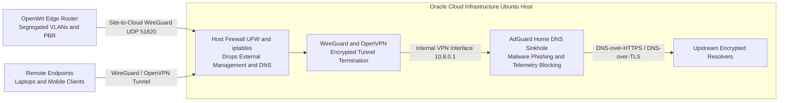

# Zero-Trust Cloud VPN Gateway & DNS Sinkhole on OCI

A self-hosted, hardened cloud network gateway deployed on **Oracle Cloud Infrastructure (OCI)** combining **WireGuard** and **OpenVPN** encrypted tunneling with **AdGuard Home** DNS-level threat filtering. Management interfaces and DNS resolvers are bound strictly to internal VPN tunnel interfaces (`10.8.0.0/24`) and enforced via **UFW/iptables** firewall rules, eliminating public attack surface while providing split-tunnel Policy-Based Routing (PBR) for remote **OpenWrt** edge routers and mobile endpoints.

---

## Architecture Overview



---

## Security & Network Engineering Controls

* **Zero Public Management Exposure:** AdGuard Home (`:3000`) and WireGuard management interfaces bind exclusively to the private VPN gateway IP (`10.8.0.1`), making administrative panels unreachable from the public internet.
* **Closed-Resolver DNS Sinkhole:** DNS port `53` listens strictly on the WireGuard tunnel interface to prevent open-resolver DNS amplification attacks while blocking malicious domains, C2 callbacks, and trackers across all connected subnets.
* **Split-Tunnel Policy-Based Routing (PBR):** Designed to integrate with OpenWrt edge routers (`luci-app-pbr`) so designated internal subnets route through the OCI WireGuard tunnel while standard traffic egresses locally.
* **Encrypted Upstream DNS:** Forwards filtered DNS queries upstream over **DNS-over-HTTPS (DoH)** and **DNS-over-TLS (DoT)** to prevent ISP-level DNS hijacking or plaintext snooping.

---

## Tech Stack

| Component | Technology | Role in Architecture |
| :--- | :--- | :--- |
| **Cloud Host** | Oracle Cloud Infrastructure (OCI) | Hardened Ubuntu LTS compute instance |
| **Primary VPN Tunnel** | WireGuard (`wg-easy`) | High-throughput UDP encrypted tunneling (`51820/udp`) |
| **Fallback VPN Tunnel** | OpenVPN | TCP/UDP fallback tunneling for restrictive networks (`1194/udp`) |
| **DNS Threat Filtering** | AdGuard Home | Network-wide malware/phishing sinkhole and encrypted upstream DNS |
| **Perimeter Firewall** | UFW & `iptables` | Default-deny ingress policy, NAT masquerading, and interface isolation |
| **Container Runtime** | Docker & Docker Compose | Declarative service orchestration and automated restarts |

---

## Repository Structure

```text
oci-wireguard-adguard-gateway/
├── README.md                    # Architecture documentation & security controls
├── LICENSE                      # MIT License
├── docker-compose.yml           # Sanitized WireGuard, OpenVPN & AdGuard Home stack
├── .env.example                 # Environment variable template (no live secrets)
├── .gitignore                   # Excludes live secrets, keys & local configs
└── scripts/
    └── harden-gateway.sh        # UFW firewall & kernel IP forwarding hardening script
```

---

## Quick Deployment Guide

1. **Clone the repository:**
   ```bash
   git clone [https://github.com/zainn-007/oci-wireguard-adguard-gateway.git](https://github.com/zainn-007/oci-wireguard-adguard-gateway.git)
   cd oci-wireguard-adguard-gateway
   ```
2. **Configure environment variables:**
   ```bash
   cp .env.example .env
   # Edit .env with your OCI public IP and bcrypt password hashes
   ```
3. **Apply host firewall & kernel hardening:**
   ```bash
   chmod +x scripts/harden-gateway.sh
   sudo ./scripts/harden-gateway.sh
   ```
4. **Start the containerized gateway:**
   ```bash
   docker compose up -d
   ```

---

## Author

**Zain Ul Abidin** — SOC Analyst | Cloud & Network Security Engineer  
[LinkedIn](https://www.linkedin.com/in/zain-ul-abidin-7577a8242)
